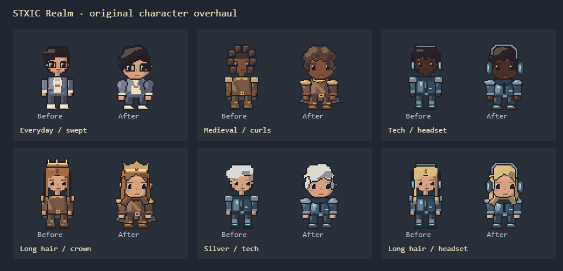
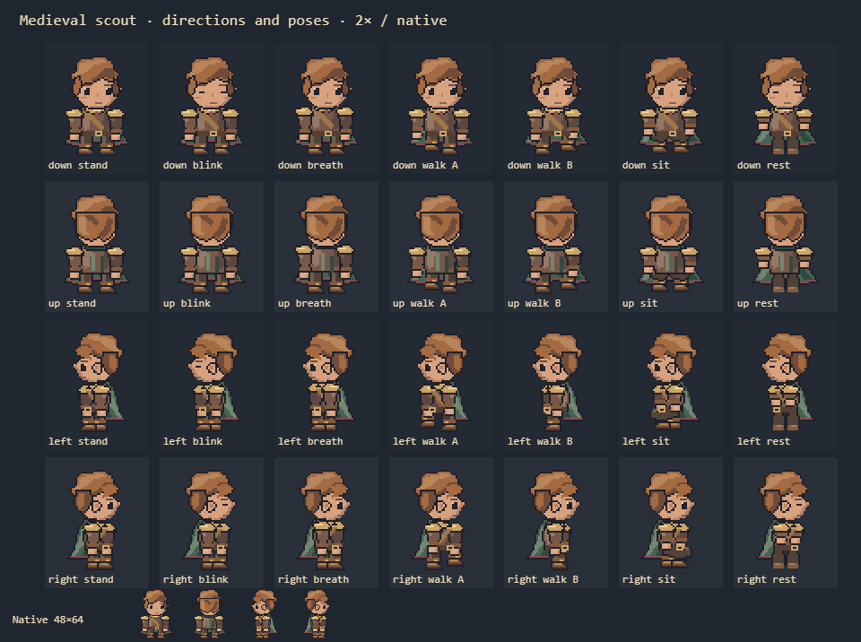

# World character artwork

3 November 2026. Owner-authorized character overhaul using the supplied pixel-character reference as visual direction. This supersedes the 2 November smaller-head/longer-leg treatment. Artwork is original code-authored pixel art; no reference pixels, downloaded sprites or generated bitmap assets are shipped.

`apps/web/src/character.ts` retains the 48×64 grid and bottom-center (24,64) pivot. Native-scale inspection showed enough room for expressive faces and clothing without increasing resolution. Broad cheeks, a stepped chin, separated brows/eyes, a small mouth and ears establish the head; the compact body has connected sleeves, thumb-notched hands and distinct boots. The support sole still ends at y63. Headgear begins at y2 and remains inside the portrait crop.

## Art rules

- Author the silhouette first. Use contiguous stepped contours, consistent dark `#202029` outlines and large connected color clusters. The deterministic contour rasterizer samples pixel centers, insets by one pixel for outlines, caches geometry and merges equal vertical runs into rectangles. Both rendering backends receive identical integer rectangles; no vector antialiasing, smoothing, gradients or higher-resolution substitute is used.
- Keep skull and headgear stable through walking and breathing. Front/rear and profile views share cheek/chin, shoulder, hip and sole heights. Profile geometry is mirrored; upper-plane light clusters and a single shadow ramp define volume without noisy strands or material texture.
- Short hair has a broken fringe and tapered nape; swept hair has an asymmetric wave; curls use a continuous lobed contour with grouped highlights; long hair has separated scalloped shoulder locks. Headphones and crowns fit the skull envelope, and glasses frame the visible eyes. Keep selected skin, hair and iris colors visible after layer compositing.
- Everyday clothing is an open chore jacket with folded lapels, linen shirt, pockets and light shoes. Medieval clothing is a leather jerkin, brass gorget/pauldrons, diagonal baldric, buckled boots and a flared green mantle with burgundy lining. Tech clothing is a cropped utility shell with chamfered steel panels and restrained cyan hardware. Preserve the saved outfit base colors and derive limited material ramps around them.
- Animate whole connected limbs with opposing arm/leg phases and a grounded support foot. Idle uses one pixel of chest movement and a brief blink in a four-second phrase. Sitting has bent thighs, vertical shins and supported hands; bed rest brings the legs together, relaxes the arms and closes the eyes. Preserve costume volume and attachment through every pose.

The medieval scout is the representative target. The same anatomy and contour rules cover every existing option: five skins, five hair colors, four hairstyles, four iris colors, three outfits and four accessories (4,800 combinations). All twelve starters currently present in Character Studio are retained, including the owner's pre-existing uncommitted additions.

## Integration boundaries

Home's Phaser 3.90 renderer, personal/shared HallTraveler SVGs, Character Studio, portraits and composed scenes continue to consume the same pixel functions. There is no parallel sprite-sheet wardrobe. Existing world display scale (0.66), movement cadence, bottom-center transforms, collision footprints, furniture anchors, furniture foreground occlusion, layouts and permission logic remain unchanged. Inspection sheets use native 1× and integer 2×/3× nearest-neighbor views; responsive world fitting retains its existing fractional scale.

No Studio controls or account appearance schema were changed in this pass. Existing direction/pose controls, drafts, saves, palettes and IDs retain their meaning. Account photos and profile banners remain separate. Existing timers, reduced-motion and hidden-document gates, teardown and asynchronous lifecycles are preserved. Rest stays still; seated characters may blink and breathe.

## Asset family / provenance manifest

| Source | Canvas / pivot | Variants | Motion / pose | Use |
| --- | --- | --- | --- | --- |
| `character.ts` resident layers | 48×64 / 24,64 | Existing 5 skins × 5 hair colors × 4 hair silhouettes × 4 eyes × 3 outfits × 4 accessories; four directions | Neutral, walk A/B, blink, inhale, seated, supine rest | World resident, shared SVG inspection |

Provenance: original TypeScript contour coordinates and pixel clusters authored for Realm in this implementation. The owner's supplied 3 November fantasy-character montage informed proportions, silhouette clarity and outline treatment only; its reuse rights are not established and none of its artwork is copied or included as a runtime asset. No external package, generator, image service or engine migration was used. The two compact PNGs above are deterministic exports of Realm's own before/after source. Backgrounds and companions in captures are existing Realm artwork, including the owner's uncommitted changes.

## Repeatable evidence

`node apps/web/scripts/verify-character-art-ui.mjs` exports 48 sampled appearances × four directions × seven states at 1×/3× (2,688 rendered cells per before/after family), captures actual Studio/Home and a real Phaser room with multiple residents, Village Cat, Triarch and Wisp at desktop/390px, and compares all 16 Studio view/pose combinations to shared source under reduced motion. It also checks idle animation and hidden/reduced-motion pauses. Unit coverage checks all 4,800 combinations across the four directions and seven states, fixed support soles and palette immutability. Additional composited-pixel checks verify visible hair/skin/irises, distinct hairstyles under headgear, stable skulls/equipment and closed eyes for blinking/resting.

For this pass set `REALM_CHARACTER_ART_OUTPUT=.impeccable/review/character-overhaul`. `--before` saves baseline source and captures before editing; `--before --sheets-only` re-exports that source without overwriting the in-world captures. The normal run also exports `poses.png` and, when baseline source exists, `comparison.png`. Baseline/captures, detailed sheets, browser results and the final verification report remain in that local ignored evidence directory. Earlier evidence remains under `.impeccable/review/character-art`.

These are lead-run local browser fixtures. They do not establish live authenticated multiplayer behavior, physical-device rendering, Safari/assistive-technology coverage or independent art approval. The existing two opposing walk phases and grid movement cadence are retained; this pass does not add a skeletal animation system or change authoritative movement timing.
