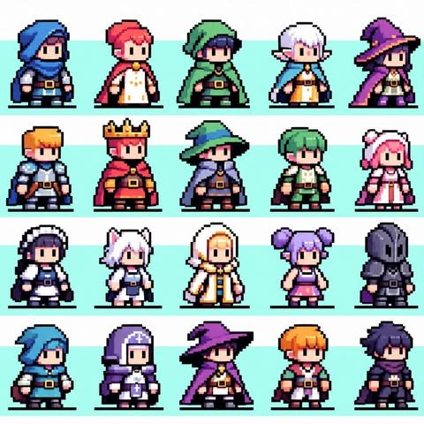

# World character artwork and flexible archetype specification

4 November 2026. Owner-authorized update expanding Realm's character specification to flexibly support rich fantasy class archetypes—including wide-brim mages, armored knights/paladins, hooded rogues, beastkin, elves, royals, and clerics—as visual directions. Artwork remains original code-authored pixel art executed within Realm's procedural rasterizer; no reference pixels or static bitmap sprite sheets are shipped.

`apps/web/src/character.ts` retains the foundational 48×64 canvas and bottom-center `(24, 64)` pivot, but relaxes anatomical and silhouette boundaries so that diverse headgear, ears, visors, capes, and garment silhouettes fit cohesively into the world.



---

## 1. System invariants (non-negotiable boundaries)

To ensure that world collision, depth sorting, furniture interaction, and viewport scaling remain fully functional across Phaser 3.90, SVG inspection, and Character Studio, the following system invariants remain fixed:

- **Canvas & Pivot:** Native grid is 48×64 pixels with the anchor point fixed at bottom-center `(24, 64)`.
- **Grounding Sole:** The support foot/sole strictly terminates at line `y63`. Characters must never float or sink into floor tiles.
- **Top Clearance:** Tallest headgear (wizard hat points, helmet crests, crown tips, animal ears) starts no higher than `y2`, ensuring complete clearance inside avatar circles and portrait crops.
- **Integer Rasterization:** All geometry is deterministically rasterized into integer rectangles with consistent `#202029` dark contours. No vector anti-aliasing, smoothing, gradients, or blurring.
- **Collision & Movement Authority:** Cardinal collision footprints, 0.66 default world scale, and server-owned movement checks are independent of character appearance.
- **Account Separation:** World pixel characters represent spatial presence in rooms and halls; they remain strictly decoupled from account profile photos and banners.
- **Accessibility & Motion Gates:** Animations pause under `prefers-reduced-motion` and when browser tabs are hidden.

---

## 2. Flexible art and silhouette rules

The rules below replace rigid one-size-fits-all garment and facial constraints with flexible ranges tailored for diverse fantasy and modern archetypes:

### A. Silhouette & envelope flexibility
- **Horizontal Breadth:** The silhouette may extend up to 44 pixels wide (leaving at least 2px padding on each side of the 48px canvas) to accommodate wide-brim witch/wizard hats, flared cloaks, shoulder pauldrons, wing-like elf ears, or billowing mantles.
- **Vertical Headroom (`y2`–`y16`):** Reserved for expressive headwear: conical pointed wizard hats, spiked monarch crowns, hooded cowls, bear/cat hoods, and horned or crested knight helmets.
- **Volume & Clustering:** Shading uses large, connected color clusters with clean 2-to-3 tone ramps (base, shadow, and minimal highlight). Avoid noisy dithering or isolated single-pixel speckles.

### B. Head, facial expression, and head coverage modes
Characters can use any of three distinct head-coverage modes:
1. **Open Expressive Face:** Broad cheeks, stepped chin, distinct 2-pixel vertical eyes (with customizable iris color), subtle brows, and ears.
2. **Shadowed / Hooded Cowl (Rogues, Mages, Monks):** A deep cowl casts a prominent shadow over the upper face; eyes peer out with high-contrast irises or mystical luminescence against the shadow tone.
3. **Full Enclosed Helmet / Visor (Knights, Dark Paladins):** Face is completely enclosed in steel or obsidian plate. Features horizontal, T-shaped, or vertical slit visors. Instead of an eyelid blink, idle animation uses a subtle single-pixel visor sheen/glint.

### C. Species & ear traits
- **Human:** Standard round ear silhouettes nestled beneath hair locks.
- **Elf / Fae:** Extended horizontal/angled pointed ears protruding through hair and hooded openings.
- **Beastkin / Animal Traits:** Upright feline or lupine ears positioned on the crown of the skull (`y8`–`y18`), with distinct inner-ear contrast tones.

### D. Hairstyles & volume
- **Short / Tapered:** Broken fringe, side tufts, and tapered nape.
- **Swept / Spiky:** Asymmetric wave or spiked anime rogue tufts with directional volume.
- **Twin Buns / Pigtails:** Lobed lateral silhouettes extending beyond the skull envelope.
- **Long / Scalloped:** Straight or wavy locks draping over shoulders and behind the torso.
- **Headdress Integration:** Hair geometry adapts beneath hats and hoods—bangs and side-locks peek out naturally from cowls, wimples, and wide brims.

---

## 3. Modular layering architecture

Outfits are no longer restricted to only three rigid garments (jacket, scout, tech). The rendering pipeline accepts a flexible 8-tier modular layering stack:

```
[Layer 7: Forefront Accents] -> Buckled belts, baldrics, brooches, cowl scarves, holy pendants
[Layer 6: Headgear]          -> Witch hats, cowls, helmets, crowns, wimples, animal hoods, glasses
[Layer 5: Hair Front]        -> Bangs, side-locks, fringes
[Layer 4: Facial Features]   -> Open eyes/mouth, hooded eye glint, or helmet visor slit
[Layer 3: Head Base & Ears]  -> Skin tone skull, human ears, elf ears, or beastkin ears
[Layer 2: Torso & Garments]  -> Tunic, robes, plate armor cuirass, maid apron, dress, utility shell
[Layer 1: Body & Boots]      -> Limbs, boots, leggings, folded cuffs, hands with thumb notches
[Layer 0: Back Attachments]  -> Cloaks, flowing capes, mantles, long back hair
```

### Archetype reference palette & garment sets
- **Wizards & Witches:** Conical wide-brim hats with buckled bands, flowing dual-tone cloaks, high-collared tunics, and mystic robes (rich violet, midnight blue, emerald green).
- **Knights & Paladins:** Steel breastplates, articulated pauldrons, greaves, buckled leather sword-belts, and optional heraldic mantles (polished silver, burnished brass, shadow obsidian).
- **Rogues, Rangers & Assassins:** Asymmetric cowl hoods, face-covering scarves, fingerless gloves, dual-tone leather vests, and utility baldrics (forest green, slate charcoal, deep crimson).
- **Clerics & Healers:** Hooded habits, wimples/veils with cross/star insignias, and gold-embroidered vestments (pure white with gold trim, deep mauve, celestial blue).
- **Royals & Nobles:** Gemmed golden crowns, ermine-collared velvet mantles, ornate gold brooches, and regalia tunics (royal red, regal purple).
- **Cozy & Themed:** Animal-eared fleece winter hoodies, maid dresses with ruffled lace headbands, and casual travelers' attire.

---

## 4. Animation and pose flexibility

All archetypes adapt seamlessly across Realm's standard 7 animation states:

- **Idle:** 1-pixel vertical chest motion. Open faces execute a natural blink every ~4 seconds; fully helmeted knights execute a 1-pixel visor reflection glint; resting beasts have a subtle ear twitch.
- **Locomotion (Walk A/B):** Two opposing limb phases with grounded support foot. Back capes and mantles shift by 1–2 pixels to convey fluid movement.
- **Sitting:** Bent horizontal thighs, vertical shins, hands supported on knees or lap. Capes and long robes drape naturally over the chair seat behind the character's feet.
- **Supine Bed Rest:** Legs brought together, arms relaxed by sides, eyes closed (or visor darkened). Complete stillness.
- **Reduced Motion:** When active, continuous breathing/blinking halts; characters render in crisp neutral poses.

---

## 5. Integration and extensible schema

- **Extensibility:** The 5 skins × 5 hair colors × 4 hairstyles × 4 eyes × 3 outfits baseline serves as the starting core, but the schema allows arbitrary addition of new headgear IDs, cape IDs, ear trait IDs, and garment IDs without requiring database schema rewrites.
- **Portraits and Previews:** The same procedural drawing routine automatically provides cropped avatar portraits, Character Studio previews, and in-game Phaser world sprites.
- **Verification:** `node apps/web/scripts/verify-character-art-ui.mjs` verifies palette immutability, grounded sole alignment (`y63`), headgear clearance (`y2`), and proper layer occlusion across all combinations and directions.
