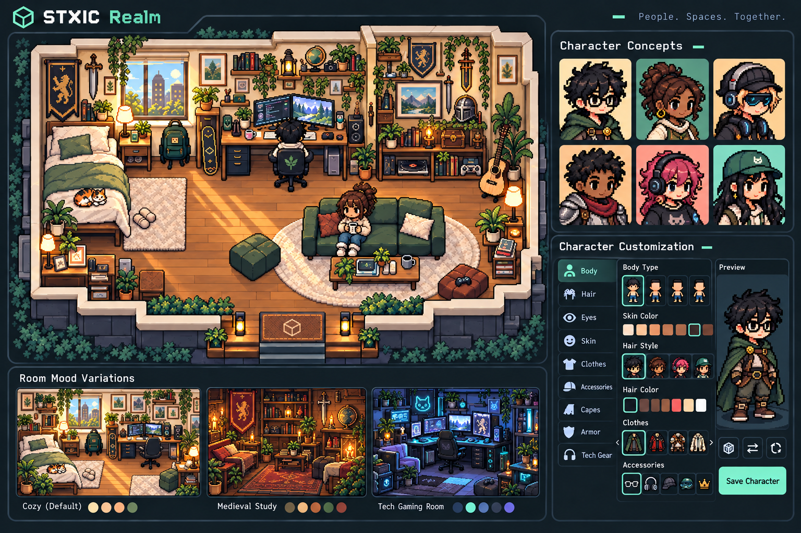

# Rooms, avatars and character customization: visual reference

**Status:** Exploratory direction, 28 October 2026. The owner supplied references and asked for a concept and documentation. The new concept and recommendations below are starting points for review, not approved final assets, implementation commitments or proof that features exist. See [implementation status](IMPLEMENTATION.md) for what works today.

The latest concept adds medieval and tech-inspired room and character options. The [previous revision](images/realm-room-character-concept-v2.png) remains available. The revised image follows the owner's request for characters closer to the supplied pixel-art references and retains a visible character customization editor. It remains a mood exploration awaiting owner review. The [earlier concept](images/realm-room-character-concept.png) is preserved for comparison. Its cube logo, tagline, furniture, pets, clothing and colors are illustrative, not approved brand assets or feature commitments; use the separate logo reference for the current preferred mark direction.

## Intent

Realm is a place for friends to communicate and make spaces their own. Its pixel homes should feel inhabited and personal; characters should be expressive and recognizable. The owner wants the product to be free and its features customizable, including logo colors. The scope and mechanics of customization and any future business model remain open; do not infer a finalized pricing policy or feature list.

Chat is the core experience. A user should be able to communicate without entering a room. Pixel spaces add personality and social presence without turning the product into a mandatory fantasy game.

## Reference images

- [Room reference](images/references/room-inspiration.png): an inhabited room with a desk, seating, books, plants and personal objects. Useful for mood and detail; its dark purple palette and glowing portal are not requirements.
- [Avatar reference](images/references/avatars-inspiration.png): recognizable pixel portraits and varied appearances. The fantasy setting, dashboard layout and shown features are inspiration only.
- [Character editor reference](images/references/character-editor-inspiration.png): categories and a character preview suggest a possible customization flow. Specific options and features shown, including a market and quests, are not approved scope.

These supplied images are visual references; their provenance and reuse rights are not established. Do not ship copied artwork as production assets without confirming rights. Create original or appropriately licensed artwork.

## Rooms and homes

**Desired qualities:** cozy, readable, welcoming and individual. A home should communicate something about its owner through furniture and arrangement, rather than a fixed world-wide aesthetic. Use the reference's sense of a lived-in space while leaving enough open floor to navigate and see characters and objects.

**Possible moods, not fixed themes:** a light, plant-filled room; a warm wooden study; or a darker gaming room. Start with neutral materials and use color through furniture, decor, lighting and user choice. Purple can be an option, but a purple cast, neon glow and permanent nighttime setting should not define every home.

**Visual approach:** coherent pixel art, consistent grid and scale, crisp nearest-neighbor rendering, clear silhouettes and contrast. A limited palette per room can support a range of moods. Convey depth and interaction without obscuring names, paths, objects or text. The concept is illustrative; camera angle, asset resolution, grid size and exact proportions need prototyping and validation. Existing project plans provisionally describe a top-down grid; the perspective in the concept does not settle the camera decision.

**Medieval and tech choices:** Offer room and character directions that can be mixed with everyday styles: for example, banners, books, lanterns, cloaks and light armor alongside computers, headphones, modern jackets and tech accessories. These are visual examples, not a finalized catalog or a requirement that every room use both styles. The default room and the exact sets remain to be decided.

**Personalization candidates:** floor and wall finishes, furniture placement, decor, color and lighting. Explore defaults that feel useful before any editing, with choices that allow users to make different kinds of rooms. Placement rules, rotation, asset budgets, room size, upload support and available items remain open or governed by the existing feature plan.

## Avatars and characters

Follow the supplied references for compact pixel-art character proportions, dark pixel outlines, expressive faces, detailed hair and layered clothing. The owner wants a character customization editor retained alongside default avatars. Offer a welcoming set of starter appearances as an easy entry point, with variation in skin tones, hair textures, hairstyles and presentation. Avoid making fantasy costumes the only identity; casual clothing and other styles can coexist. Distinct shapes and colors should remain readable in the room as well as in profile portraits.

**Customization editor direction:** retain an editor with categories and a character preview, inspired by the supplied reference. Exact controls and initial scope need design and implementation. **Customization candidates:** skin tone, hair style and color, eyes, clothing and accessories; body options where workable. These are design candidates, not a finalized catalog. Avoid assuming gender from a combination of choices. Evaluate accessible controls and labels, and allow people to preview the result before saving.

For implementation, design portraits and world sprites as a consistent character identity. The artwork must accommodate the views, movement frames, layering and equipment combinations eventually chosen; the generated concept is not a sprite sheet and does not specify those assets.

## Interface relationship and accessibility

Keep app navigation and chat visually quiet and legible around the room. Use accents for controls and states, not as a color wash over every surface. The viewer's app theme is distinct from the owner's public home and profile appearance; define what each choice affects before implementation. Make interactive objects identifiable without relying on color alone, preserve keyboard access and text/list alternatives for spatial tasks, and respect reduced motion. Validate contrast in actual themes and states.

## Current reality and next steps

The current room preview and Home Studio are local prototypes using placeholder artwork. They do not demonstrate shared homes, account-backed character customization or the look in this concept. See [implementation status](IMPLEMENTATION.md) and [features](FEATURES.md).

1. Review the concept with the owner and choose a visual direction for a first representative home and avatar.
2. Prototype camera angle, sprite scale, readability, navigation and a small original furniture set together; test with realistic content and screen sizes.
3. Decide which customization choices belong in the first usable release, how defaults work, and how appearance is saved and shown to others.
4. Define production art specifications and a practical asset pipeline only after the above decisions; validate rights before release.

Related: [overall visual direction](VISUAL_DIRECTION.md), [design and experience](DESIGN.md), and [features and behavior](FEATURES.md).

## Original local implementation — 28 October 2026

The owner subsequently requested implementation of an overhaul and delegated the artwork direction. The shipped local slice now has an obsidian shell, original layered pixel furniture/architecture, six starter character looks and an appearance workbench. Cozy/medieval/tech material palettes remain independent from the app theme. Editable full characters, cropped portraits and the room sprite share one original drawing. This implements a coherent first art direction; the generated concepts above remain inspiration, not pixel-accurate production specifications. See [current design](DESIGN.md#implemented-art-and-workbench) and [verification/limits](IMPLEMENTATION.md#obsidian-visual-overhaul--28-october-2026).
