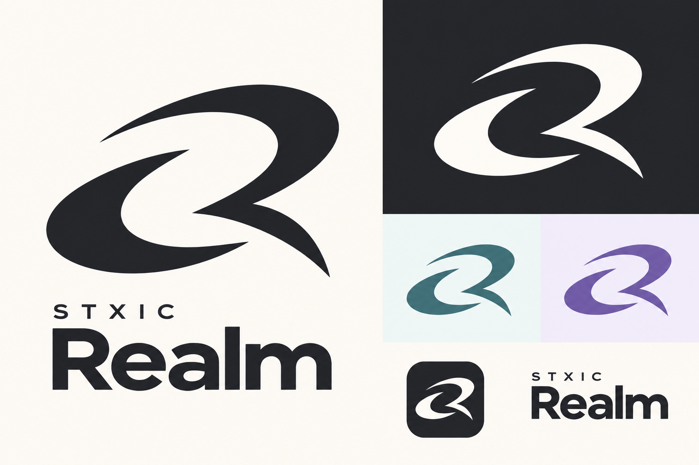

# STXIC Realm visual direction

**Status:** Owner responded positively to this concept on 28 October 2026. It is a direction for further design, not a finalized or production-ready logo. The existing app logo assets have not been replaced.

## Intent

Realm is a place for friends to communicate and make their own spaces. Its identity should feel welcoming, calm, personal and expressive. Chat remains the primary experience; pixel homes and the people who use them can bring warmth and character to the interface.

## Logo direction

- Develop the existing sweeping, orbital idea into a simpler, flat symbol with fewer elements and a subtly legible R.
- Use a single solid color for the mark so it works on both light and dark surfaces and can adapt to a user's chosen colors.
- Avoid the original treatment's central sparkle, glossy gradient, bevel and glow. Preserve clear shapes and negative space.
- The concept still feels sharp and energetic. Explore softer curves if they better communicate the welcoming feeling, without losing the recognizable silhouette.
- Check the symbol at actual app-icon and navigation sizes, including in monochrome. The concept image is illustrative, not proof of small-size legibility or an editable production asset.
- Pair the symbol with a clear STXIC Realm wordmark; refine spacing and typography when preparing the actual assets.

## Color and customization

Purple is one possible color, not a requirement for the logo or entire interface. The teal and violet in the concept are examples, not approved brand colors or fixed theme options. Choose a suitable default later, then support user-selected colors, including the logo color, with legibility and contrast appropriate to the surface. The user's goal is a free product with customizable features; the precise feature scope, pricing commitments and implementation remain to be decided.

## Interface direction

Keep the communication shell calm and readable. Use color deliberately for navigation, actions, and meaningful states rather than applying one accent everywhere. Let avatars, personal homes and user preferences give Realm its character. Avoid making gradients, glows or decorative effects the defining visual identity. This is a direction for future design, not a specification for replacing the current UI.

## Next design work

1. Refine the mark as editable vector artwork and compare a softened version with this concept.
2. Test the mark at small sizes and on light and dark backgrounds; validate color contrast in real interface states.
3. Decide the default palette and how user theme and logo-color choices should behave.
4. Review similarity, reference rights and trademark availability before public use.

The current SVG kit and its status are documented in [Brand assets](BRAND_ASSETS.md). The concept above does not supersede those files automatically.

For the pixel-room and character exploration, see [Rooms and character direction](ROOMS_AND_CHARACTERS_DIRECTION.md).

## Implemented direction update — 28 October 2026

The owner requested an obsidian default and a full original-art overhaul. The current web implementation now follows neutral obsidian surfaces with optional personal accents; the flat orbital mark remains in use. See [Design](DESIGN.md) for the current tokens and [Implementation](IMPLEMENTATION.md) for the browser-only art/editor scope. Earlier concept colors remain illustrative.
